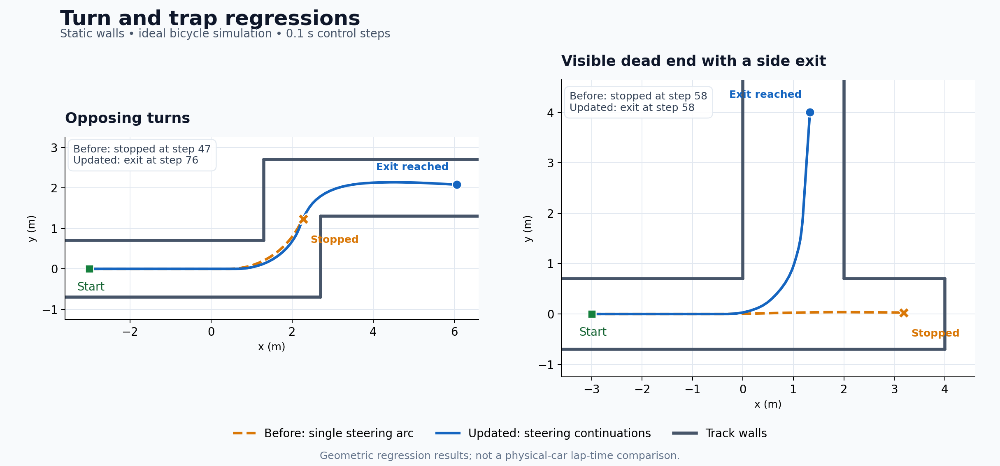

# Standalone LiDAR gap follower

`scripts/gap_follow_standalone.py` runs directly with Python after sourcing ROS
and the car workspace. It uses live LiDAR; it does not require a map or
localization. The existing `levine_*` launch files still select `reactive_node.py`.

## Why the old controller stalled in hairpins

The old controller selected a deep ray in the widest gap, used that ray's
bearing directly as a clipped steering angle, and stopped according to a
straight corridor in front of the LiDAR. Saturated steering reduced its nominal
speed to 0.15 m/s, then front clearance scaled that toward zero. In a square
U-turn regression, it approached 0.5 m front clearance and effectively stopped.
It also discarded scan angles outside ±90° and stopped for any return within
the nearest-obstacle bubble, including side returns.

The controller now:

- Scores gaps using capped depth and distance from their edges.
- Uses the gap as a steering preference, with bicycle geometry and LiDAR offset.
- Evaluates 41 feasible steering arcs over 3 m. Observed obstacles constrain a
  rectangular vehicle footprint; the leading body must remain in observed space.
- Looks ahead through up to five distinct first arcs and five continuations per
  arc, over a total 5 m planning horizon. This compares turning and straightening
  through an opening with driving into a visible dead end.
- Uses 260° of scan data by default, including side walls, and prefers wall clearance
  and continuity between steering commands. The extra-clearance reward saturates
  at 0.35 m so a wide recess does not automatically beat the through route.
- Limits speed using curvature, free travel along the selected arc, assumed
  braking response, and acceleration. Planned tighter turns can further reduce
  entry speed. Future clearance after a steering change never raises the
  first-arc braking limit. Braking and stops are applied immediately.
- Keeps invalid ranges blocked. Positive infinity is accepted as a no-return
  measurement only when `inf_is_free:=true` is explicitly configured.

Obstacle returns are consolidated into occupied 3 cm cells, with collision
padding equal to the cell half-diagonal. This preserves thin obstacle returns
while reducing computation. Additional padding bounds motion between sampled
poses. These geometric checks assume static obstacles and ideal steering.

Recorded turn scans exposed another stop/restart mechanism: the checked distance
fluctuated between 0.2 and 0.3 m, crossing the former hard movement threshold.
The planner now permits a crawl whenever checked travel exceeds the unchanged
0.15 m stop reserve. At or below 0.3 m, speed is capped at 0.15 m/s and may be
lower under the braking bound. It still stops for occupied or unobserved paths.
Geometric stops preserve the previous steering preference while commanding zero
speed; malformed/stale scans and watchdog stops reset it.

## Run and diagnose

The calibrated hardware configuration in `f1tenth_stack/config` remains the
source of truth for the car. Running this Python file starts only the planner;
bringup starts the LiDAR, joystick, mux and VESC drivers. The planner has its own
parameters and does not automatically import the hardware YAML files.

On this car, use the following setup in **each terminal**:

```bash
cd /home/kit/f1tenth_ws
source /opt/ros/humble/setup.bash
source install/setup.bash
export ROS_DOMAIN_ID=42
```

Domain 42 is the domain observed on the running car. All terminals must use the
same domain. If bringing this workspace to another car, use that car's domain.

In terminal 1, start hardware bringup if it is not already running:

```bash
ros2 launch f1tenth_stack bringup_launch.py
```

In terminal 2, run the planner against the normal mux input:

```bash
python3 src/gap_follow/scripts/gap_follow_standalone.py --ros-args \
  -p max_speed:=0.5 --log-level gap_follow_standalone:=debug
```

The speed override is a temporary test ceiling; it does not edit the calibrated
VESC settings. Running the Python file directly requires no rebuild. If it is
already running when the file changes, stop that process with Ctrl+C and restart
it to load the edits.

With your installed joystick configuration, hold **R1 alone** (button index 5)
to allow autonomous commands through. With no buttons pressed, `joy_teleop`
publishes zero-speed `/teleop` commands at a higher priority than `/drive`.
R1 suppresses that default command; after the 0.2 s mux timeout, `/drive` is
eligible. L1 (button index 4) selects manual driving and keeps joystick priority.
R1 does not override an algorithm stop or start the Python process. Avoid other
buttons during this handoff: the current default-action code suppresses its
stop command whenever any button is pressed, not exclusively for R1.

The actual command chain in this repository is:

```text
/scan -> gap_follow_standalone -> /drive -> ackermann_mux
       -> /ackermann_cmd -> ackermann_to_vesc_node -> /commands/motor/speed
```

For a dry run that cannot feed the navigation input, remap the output:

```bash
python3 src/gap_follow/scripts/gap_follow_standalone.py --ros-args \
  -r /drive:=/gap_follow_test -p max_speed:=0.5 \
  --log-level gap_follow_standalone:=debug
```

With that `/gap_follow_test` remap, R1 will not route this planner to the motors.
Remove the remap when using the normal driving command above.

If the car does not move, these read-only checks distinguish the stop location:

```bash
ros2 topic echo /drive --once --field drive
ros2 topic echo /ackermann_cmd --once --field drive
ros2 topic echo /joy --once --field buttons
```

| Observation | Meaning |
| --- | --- |
| `/drive` speed is zero | The planner is requesting a stop; read its reason in terminal 2 |
| `/drive` is positive but `/ackermann_cmd` is zero | Check joystick/mux selection; while holding R1, `buttons[5]` should be 1 and `buttons[4]` should be 0 |
| Both commands are positive | The planner and mux are passing motion; inspect VESC/driver status |
| No `/scan`, `waiting_for_scan`, or `scan_timeout` | Check bringup and matching ROS domains |

The hardware snapshots used during diagnosis had valid scan data and a connected
command chain, but repeated `no_safe_path` decisions with a 270° planning sector.
The far-left/rear scan edge at +135° reported about 0.25–0.38 m, while the side
walls were roughly 0.7–1 m away. Many of these peripheral points project inside
the new padded footprint and veto every path. This is consistent with a
self-return or an obstructed scan edge, rather than the distant track walls.

The default `forward_fov_deg` is now **260°** (±130°). This omits the outer 5° at
each rear edge while retaining both ±90° side-wall directions and the complete
front sector. It does not reduce the vehicle clearance margin or alter the
LiDAR driver's calibrated configuration. Excluded sectors remain unobserved;
real obstacles exclusively in those rear sectors cannot be checked. The exact
physical source of the peripheral return has not been established.

The setting can be made explicit at startup with `-p forward_fov_deg:=260.0`.
Restart a running Python process to load the changed default. Restoring 270°
includes the suspect rear-edge returns again.

Parameters are read-only after startup. Restart to change them. There is no
reverse recovery: if all forward arcs are blocked, `no_safe_path` commands a stop.
Other stop reasons distinguish invalid data, stale timestamps and scan timeout.
Debug logs report front distance, `path` (checked first-arc distance), `plan`
(selected continuation distance), gap bearing, steering and commanded speed.
Geometric stop logs retain the best checked distance instead of always reporting
zero, so clearance limits can be distinguished from missing scan data.

Check command ownership with `ros2 topic info /drive -v`. The supplied
`wall_follow_pkg/launch/car_autonomy.launch.py` starts both wall-follow and safety
publishers on `/drive`. Running this script alongside wall-follow gives competing
autonomous commands. The existing safety node also publishes onto that same
topic; that arrangement does not provide a latched priority brake through the
mux. Its `brake()` assigns `last_break_time` while its hold logic reads
`last_brake_time`. Those separate integration issues have not been changed here.
Use one navigation controller and validate the car's independent stop/mux behavior.

## Geometry and tuning

All distances below are metres. Keep the existing hardware calibration. The
new planner's footprint and motion-model assumptions are separate from it.

| Parameter | Default | Meaning |
| --- | ---: | --- |
| `wheelbase` | 0.33 | Rear axle to front axle; matches the VESC odometry config |
| `lidar_offset` | 0.27 | Matches the physical car's calibrated bringup transform; simulator override is 0.275 |
| `vehicle_front` | 0.43 | Rear axle to frontmost body point; initial estimate |
| `vehicle_rear` | 0.12 | Rear axle to rearmost body point; initial estimate |
| `bubble_radius` | 0.25 | Half vehicle width plus lateral clearance margin |
| `forward_fov_deg` | 260.0 | Usable scan sector, ±130°; excludes the obstructed peripheral region |
| `max_steering_angle` | 0.35 | Calibrated road-wheel angle limit, radians |
| `max_speed` | 1.5 | Speed ceiling; use 0.5 for initial physical tests |
| `max_lateral_accel` | 1.5 | Assumed lateral acceleration limit, m/s² |
| `braking_decel` | 2.5 | Assumed effective braking deceleration, m/s² |
| `reaction_time` | 0.30 | Allowance for sensing, computation and actuation, seconds |
| `max_acceleration` | 1.0 | Commanded speed increase limit, m/s² |
| `stop_distance` | 0.15 | Unused travel reserved before the checked path ends |
| `min_path_distance` | 0.30 | At or below this checked travel, apply the crawl cap |
| `slow_distance` | 1.5 | Checked travel needed for full nominal cruise speed |
| `path_horizon` | 3.0 | Maximum distance evaluated along each arc |
| `planning_horizon` | 5.0 | Total horizon for a first arc plus its continuation |
| `branch_distance` | 0.9 | Travel along the first arc before evaluating a steering change |
| `comfort_clearance` | 0.35 | Maximum extra wall clearance rewarded by the score |
| `crawl_speed` | 0.15 | Additional speed ceiling when checked travel is short |

**Parameter migration:** `stop_distance` previously meant a 0.5 m straight-front
LiDAR threshold. It now means a 0.15 m reserve along the swept-body-checked path.
`slow_distance` likewise refers to that path, not a front ray. Remove old
front-distance overrides when testing this version. `stop_distance` must be
less than `min_path_distance`.

At the default steering limit, rear-axle turning radius is
`wheelbase / tan(max_steering_angle) ≈ 0.90 m`. Lowering clearance thresholds
cannot make a physically tighter turn possible. Use your established calibration
and test left and right hairpins from different entry positions. Do not increase
the steering limit just to hide poor entry positioning.

The speed bound solves `v * reaction_time + v² / (2 * braking_decel) <= available`
and also enforces `v² * abs(curvature) <= max_lateral_accel`. These depend on
actual traction, braking and actuator response. They use commanded speed, not
measured odometry. `min_speed` never overrides a lower safety bound. Acceleration
uses elapsed callback time, capped at 0.1 s; speed reductions are immediate.

If a stop coincides with missing returns, inspect the scan values and the
driver's convention. Enable `inf_is_free` only if positive infinity means no
obstacle within `range_max`. NaN, negative infinity, zero and out-of-range finite
values stay invalid under either setting.

For repeatable tuning, record `/scan`, `/drive`, `/odom` and `/rosout`; compare
completion rate, minimum clearance, steering oscillation, computation latency
and lap time on the same courses. Establish reliable low-speed completion before
raising `max_speed`. Profile on the car: a 40 Hz scan offers 25 ms per callback.
The watchdog cannot interrupt a blocked callback or a failed process.

## Validation and limits

```bash
python3 src/gap_follow/scripts/gap_follow_standalone.py --self-test
python3 -m unittest discover -s src/gap_follow/test -v
```

The tests raycast static line-segment tracks and integrate bicycle motion,
checking the body against walls between control steps. They cover mirrored
smooth and square hairpins, displaced corridor entries, close obstacles, scan
ordering, invalid data and speed bounds. They do not establish performance on
the physical car: steering transitions, tire slip and scan distortion are not
simulated.

This remains a local reactive controller. Finite-resolution scans cannot certify
empty space between beams. The rear blind region is not fully observed, and
steering arcs assume their requested steering angle is achieved immediately.
It cannot guarantee a route out of arbitrary dead ends or optimal lap times on
every track. The two-stage search improves visible exits and changes of width;
it does not know which unseen branch belongs to the racetrack. More general
recovery requires local memory or a route reference. Physical steering-response
and braking measurements must support the model before increasing race speed.

The regression suite includes mirrored hairpins, opposing turns, a wide/narrow/
wide S bend, broad side recesses and forward dead ends with visible side exits.
The earlier single-arc controller failed the forward-pocket cases and one
opposing-turn direction. The continuation planner completes these geometric
rollouts. Replaying the 30 recorded turn scans yields moving crawl commands in
all 30; the earlier hard threshold stopped on 19. This is offline evidence,
not a claim of physical lap-time improvement.



## Racing algorithms considered

This implementation combines ideas suitable for live LiDAR without a prebuilt
map. It is a sampled local planner, not a full implementation of MPC, DWA,
LocalMap, or a learned racing policy.

| Approach | Relevant evidence and idea | Use here |
| --- | --- | --- |
| [Disparity Extender](https://nathanotterness.com/2019/04/the-disparity-extender-algorithm-and.html) | The author reports a 2019 F1TENTH win, but also documents wide-to-narrow turns misleading the farthest-ray strategy. | Retain disparity inflation for opening proposals; evaluate feasible continuations before choosing a direction. |
| [Dynamic Window Approach](https://www.cs.cmu.edu/~dfox/abstracts/colli-ieee.abstract.html) | The original approach filters candidate motions by collision avoidance and stopping ability before scoring them. | Borrow braking-admissible motion selection, adapted to Ackermann arcs. We do not implement its full dynamic-state/reachable-velocity window. |
| [LocalMap racing](https://arxiv.org/html/2401.17732v1) | A scan-derived local corridor supports planning without a prebuilt map or global localization; the paper reports 8.8% faster laps than FTG in simulation. | Its emphasis on onward corridor progress informs the design. We use observed-space continuation checks rather than assuming an unseen boundary has constant width. Explicit boundary reconstruction remains future work. |
| [RaceMOP](https://arxiv.org/html/2403.07129v2) | Combines a base planner and learned residual decisions; the paper identifies a remaining simulation-to-real gap. | Retain body-aware geometric checks. No learned policy is deployed; it needs training, dynamic-state inputs and real-car validation. |

For competition tuning, compare completion rate and lap-time distributions on
the same courses at the same speed ceiling. Include both directions, displaced
entries, narrow exits and misleading recesses. Increase speed only after the
planner consistently chooses the correct route; a higher ceiling cannot repair
a bad entry line. Runtime also matters: representative 1081-beam callbacks here
measure roughly 26–30 ms after pruning work beyond already-unobserved portions
of trajectories; this does not establish a worst-case 40 Hz deadline.

References: [F1TENTH gap-following lab](https://github.com/f1tenth/f1tenth_lab4_template)
and the [original disparity extender explanation](https://nathanotterness.com/2019/04/the-disparity-extender-algorithm-and.html).
