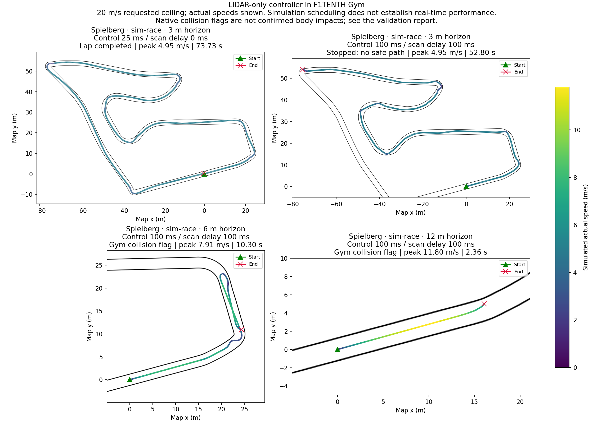

# Turn robustness and racing validation

The turn-selection changes improve the reproduced narrowing hairpin, but the
higher-speed dynamic tests expose remaining limits. **This version is not
validated for reliable 20 m/s racing or arbitrary tracks.** Hardware YAML and
calibration were not changed by this work, and no physical drive commands were
issued.

The tested controller SHA-256 is
`d9b434a8895e4ea85e06b63b79b04981b8d476eedc9f9f8f730c64c78facacb6`.
The runs below were performed on 2026-11-04. Per-run configurations, checksums,
outcomes and trajectories are in [gym_validation](gym_validation/summary.json).

## What changed

The planner compares more steering-change timings and ranks the complete joined
route. It no longer rewards continuing the initial steering angle past its
planned change. A small preference distinguishes a route disappearing behind an
observed inner wall from a route ending at a measured outer wall. That hidden
extension is speculative and cannot increase the movement or speed allowance.
Missing data, the scan boundary and the range limit earn no such preference.

The implementation also caches beam lookup geometry while using fresh ranges
on every scan. The ROS wrapper rechecks scan freshness after processing, so an
expensive callback cannot publish a newly computed moving command from an
already stale scan.

The distorted photograph was not used to infer dimensions. Synthetic narrowing
turns include independently checked feasible reference paths. The changes address
the approach; they do not provide reverse recovery after a bad entry has already
left no forward turning room.

## Dynamic simulator results

Every row uses a **20 m/s requested ceiling**. The speeds below are simulated
actual vehicle speeds, not that parameter value. Gym includes tire dynamics,
steering slew and actuator delay. Planning receives scans only; maps and poses
are used for scoring and collision checks, not route guidance.

| Spielberg settings | Control period / scan delay | Result | Peak actual speed |
| --- | --- | --- | ---: |
| Existing planning limits, 3 m horizon | 25 / 0 ms | Lap in 124.375 s; mean 2.781 m/s | 3.099 m/s |
| Simulation racing limits, 3 m horizon | 25 / 0 ms | Lap in 73.725 s; mean 4.711 m/s | 4.954 m/s |
| Simulation racing limits, 3 m horizon | 100 / 100 ms | Stopped at a hairpin after 235.56 m; no detected body contact | 4.954 m/s |
| Simulation racing limits, 6 m horizon | 100 / 100 ms | Gym collision flag after 10.300 s | 7.910 m/s |
| Simulation racing limits, 12 m horizon | 100 / 100 ms | Gym collision flag after 2.365 s | 11.801 m/s |

The simulation racing profile uses acceleration and braking of 9 m/s² and a
lateral limit of 8 m/s², with the 0.3 s reaction allowance retained. These are
simulation experiments, not newly established physical-car limits. The 6 m and
12 m runs also extend the scan cap to 30 m and the planning horizon accordingly.

The two high-speed collision flags occurred while an independent full-body
rectangle/cell check still showed positive clearance: approximately 0.155 m and
0.170 m respectively at the flag. They are therefore **not confirmed body
impacts**. The installed Gym's native time-to-collision calculation assumes a
centered sensor despite its configured forward offset. Nevertheless, the runs
show substantial transient yaw and a mismatch between requested and actual speed;
they did not complete the course. The 3 m delayed run stopped without body
contact, with a minimum body-cell separation lower bound of about 0.040 m.

The successful 25 ms runs used ideal scheduling. Their roughly 75 ms median
callbacks missed that deadline on this host. In the isolated 100 ms / 100 ms
3 m test, callbacks took **71.6 ms median, 77.0 ms p95, 90.1 ms maximum**;
all 528 fit the 100 ms period, but the car still stopped at the hairpin.
Computation time is recorded separately from simulated time, so these results
are not evidence of a deployable 40 Hz racing controller.

Only one car and one deterministic noise seed were used. Opponent interaction,
varying grip, repeated-lap reliability and physical-car lap times remain untested.



## Other failures found

- **Simulator scan contract:** Gym adds noise after applying its 30 m limit.
  Finite readings just above the advertised maximum caused valid controller
  stops. Successful moving tests explicitly clipped these simulator overshoots.
  The raw failures are retained; physical invalid-range handling was not relaxed.
- **Levine route ambiguity:** the installed map has open corridor ends leading
  into gray unmapped space that this Gym version treats as free. Both tested
  geometry conventions drove through an open exit rather than completing a lap.
  This was recorded as failure, not collision-free lap completion. A mapless
  controller cannot infer a prescribed route from an indistinguishable open exit.
- **Speed-ceiling mismatch:** a 3 m horizon with the existing braking limit permits
  only about 3.10 m/s on a clear straight; the simulation braking profile permits
  about 4.95 m/s. At 20 m/s, braking at 9 m/s² with 0.3 s reaction time requires
  about **28.22 m plus the stopping reserve**. Setting `max_speed=20` alone does
  not test driving at 20 m/s.

Reliable higher-speed operation still needs a motion model that accounts for
actual speed, steering response and scan latency, plus lower computation cost.
Increasing the speed ceiling or ignoring a stop does not address those failures.

## Checks and reproduction

- 34 portable regression tests passed, including both turn directions,
  narrowing entries, opposing turns, misleading pockets, invalid data, speed
  bounds and the separation between occlusion preference and executable travel.
- [Six additional bicycle-model stress cases](kinematic_validation.json) passed
  on the exact controller hash above, with commanded peaks from 0.5 to 4.95 m/s.
  These use ideal instantaneous motion and do not replace the dynamic tests.
- The isolated ROS smoke test passed, including stale/invalid scans, arrival
  timeout, read-only parameters and a deliberately delayed callback. Compilation
  and whitespace checks passed.

Run the dynamic stress test without ROS or physical hardware:

```bash
python3 src/gap_follow/test/gym_race_validation.py \
  --track spielberg --geometry corrected --profile sim-race --max-speed 20 \
  --control-period 0.1 --scan-delay 0.1 --clip-sim-range-noise \
  --output /tmp/gap_spielberg
```

To reproduce the 12 m experiment, append
`--path-horizon 12 --planning-horizon 12 --lidar-range 30`.
The JSON files also retain their exact reproduction commands and simulator/map
identifiers. Neither harness writes vehicle configuration or imports ROS.
